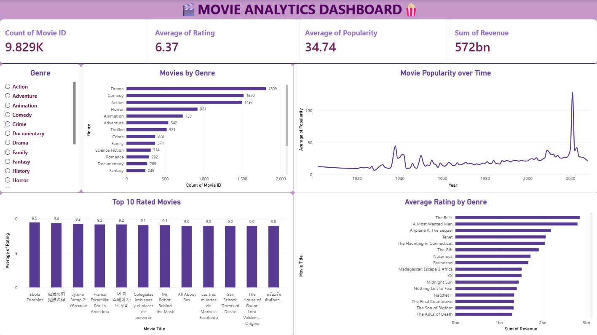

# 🎬 Movie Analytics Dashboard

## 📌 Project Overview
An interactive Power BI dashboard for exploring movie data and analyzing genres, ratings, popularity, and revenue.

## 🛠️ Tools Used
- Microsoft Power BI
- Data Visualization
- Business Intelligence

## 📊 Key Metrics
- Total Movie Records
- Average Rating
- Average Popularity
- Total Revenue

## 📈 Dashboard Features
- Movie count by genre
- Movie popularity trends over time
- Top-rated movies
- Revenue comparison by movie title
- Genre-based filtering

## 🖼️ Dashboard Preview

## 🎯 Objective
To analyze movie-related data, identify trends, and present insights through interactive visualizations.
